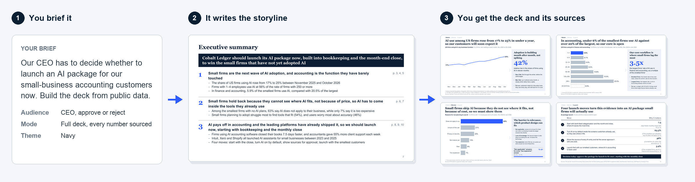
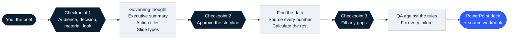
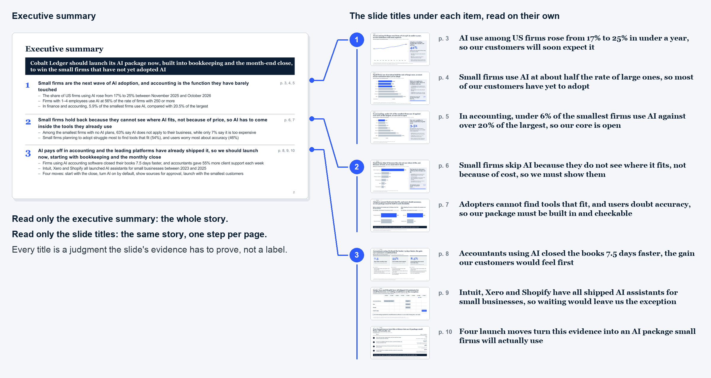
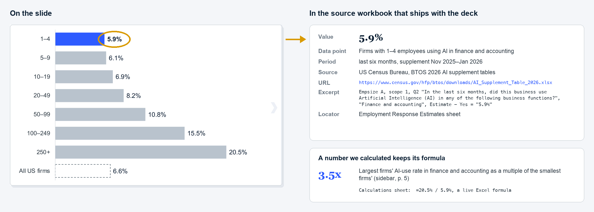
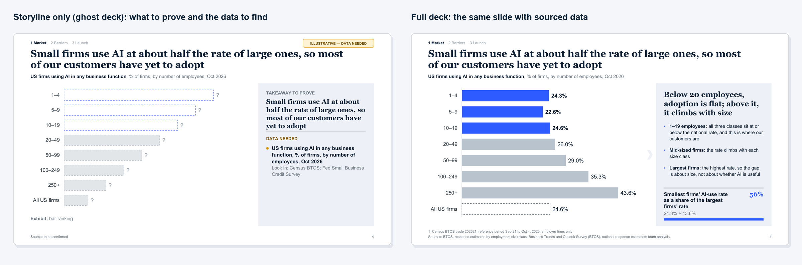
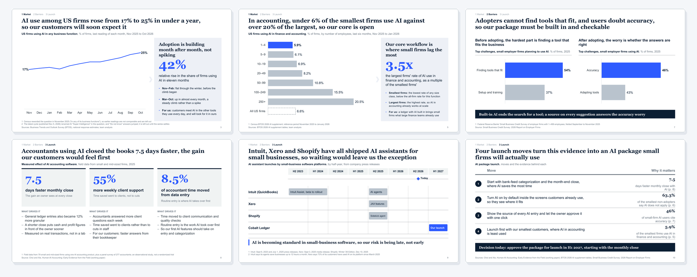
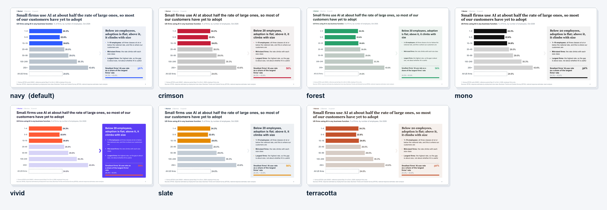

# hire-your-mck

**Brief it like a partner. Get the deck in minutes.**

A Claude Skill that turns your research, or just the decision you need to make, into a
McKinsey-style deck: a storyline that holds together, an action title on every slide,
editable PowerPoint charts, and a source for every number. It researches the data slide by slide
and hands you two files: the deck, and a separate Excel workbook that tracks every source, one sheet per slide.
Built by an ex-McKinsey consultant.



<sub>Every slide on this page comes from one real example: a fictional company, <a href="renderer/examples/cobalt-ledger.json">Cobalt Ledger</a>, deciding whether to launch AI for its small-business customers, built entirely from public data (US Census Bureau, Federal Reserve, Stanford GSB, company press releases).</sub>

## Get started

**Claude Code**

```bash
claude plugin install hire-your-mck --marketplace brianlee0113/hire-your-mck
```

**Claude.ai**: download [`hire-your-mck.zip`](https://github.com/brianlee0113/hire-your-mck/releases/latest/download/hire-your-mck.zip), then **Customize → Skills → Upload a skill**.

Then just brief it:

> Our CEO has to decide whether to launch an AI package for our small-business customers. Build the deck from public data.

[More install options](#install-details)

---

## Pretty slides are easy. The logic is the hard part.

Most AI deck tools start from layouts. This one starts where a consulting team starts: with the answer.

| | |
|---|---|
| 🧭 **A storyline that holds** | One governing thought, an executive summary whose items become sections, and an action title on every slide that the slide then proves. Read only the titles and you still get the argument. |
| 🧾 **A receipt for every number** | The skill researches the data for each slide (your files first, then the web) and keeps the sources in a **separate Excel workbook, one sheet per slide**: value, source, URL, a verbatim excerpt, and a live formula for anything calculated. No source? The slide shows "?" and says what data is needed. |
| 📊 **Real PowerPoint, not pictures** | Native, editable charts and text boxes. Edit a chart's data in PowerPoint and the chart redraws. |

---

## How it works: like a real engagement

You play the partner. The skill does the work in between and stops at three checkpoints, where a consulting team would check in with you. Each checkpoint is a multiple-choice question, never a blank page.



<sub>Dark: you decide. Light: the skill does it.</sub>

The storyline is approved **before** any data work. That is the cheapest moment to change the story, and it is the order a consulting team works in.

---

## Read only the titles: the story still holds

Each executive summary item becomes a section. Each slide title under it is a full sentence that the slide's evidence has to prove. Read down the right-hand side and you get the whole argument, one step per page.



The rules behind this are written down and checked, not left to taste. The one that matters most is **the title gives the implication, not a readout of the chart**:

| | Title |
|---|---|
| ❌ Label | AI adoption by firm size |
| ❌ Readout | Firms with 1–4 employees use AI at 24.3%, against 43.6% for firms with 250 or more |
| ✅ Implication | **Small firms use AI at about half the rate of large ones, so most of our customers have yet to adopt** |

---

## Every number has a receipt



Sources are managed apart from the slides, in `<deck>-sources.xlsx`:

| Sheet | What it holds |
|---|---|
| **Index** | Every slide, its title, and how many of its numbers are sourced |
| **p3, p4, …** (one per slide) | Each number on that page: value, unit, period, source, URL, verbatim excerpt, where in the source, date accessed, where it is used on the slide |
| **Calculations** | Every number the skill calculated, as a live Excel formula over the sourced cells, with its assumptions |
| **Sources** | Every source used in the deck, with publisher, URL and dates |

So a reviewer can check any page without opening the deck, and you can update a source and see what it touches. A number the skill calculated (a share, a gap, a multiple) lists its inputs and is a **live Excel formula** over those cells, so you can audit it or change an input.

When a number cannot be found, the skill does not guess. It asks you: a recommended value with its basis, an upload, or a wider search. Only as a last resort does the slide keep a "?" and an `ILLUSTRATIVE — DATA NEEDED` sticker.

---

## Checked before you see it

Every deck is a JSON storyline spec that a checker tests before anything is rendered. It fails the deck on things a reviewer would send back:

- a title number that is not on the slide, or a highlight the title does not name
- a sidebar that repeats what the chart already shows
- a calculated number whose formula does not recompute
- an estimate shown without its basis
- a title over 25 words, a count word ("four moves") that does not match the slide

This is the checker on the first draft of the example deck, and on the final one:

```text
$ python scripts/check.py cobalt-ledger.json          # first draft
[FAIL] A-03    slide 3    title has 27 words (max 25)
[FAIL] A-03    slide 4    title has 28 words (max 25)
[WARN] D5      slide 2    number '100' in text has no data point; add one (or remove the number)
8 content slides (0 ghost) · 49 data points · 10 sources · 2 fail · 5 warn

$ python scripts/check.py cobalt-ledger.json          # final
[PASS] schema             valid
8 content slides (0 ghost) · 49 data points · 10 sources · 0 fail · 0 warn
```

The renderer then measures every text box with the real fonts and flags anything that would overflow, so nothing spills off the slide.

---

## Three modes

| Mode | You give it | You get |
|---|---|---|
| **Full deck** | Research, files, or "search the web" | Every slide filled, every number sourced |
| **Storyline only** (ghost deck) | The decision and a few lines of context | The real exhibit on each slide with "?" values, the takeaway each slide must prove, and the data to find |
| **Single slide** | One message, or research for one slide | One finished slide |



A storyline-only deck turns into a full deck later: same spec, fill in the data.

---

## Gallery

20 slide types, chosen by what the title says (a ranking, a trend, a bridge, a set of moves, a case, a two-by-two, an issue tree, and more).



### Seven themes

The layout rules stay the same; only the colors and fonts change. The design is our own: no firm's template, colors or fonts.



---

## Install details

- **Claude Code, inside a session:** `/plugin marketplace add brianlee0113/hire-your-mck`, then `/plugin install hire-your-mck@hire-your-mck`.
- **Claude.ai:** code execution must be on (**Settings → Capabilities**); the skill runs Python to build the files.
- **What happens after the brief:** it asks a few multiple-choice questions, shows you the storyline for approval, then returns `<name>.pptx` and `<name>-sources.xlsx`.
- **Dependencies:** `python-pptx`, `openpyxl`, `jsonschema` and `pillow`, installed on first run if missing.

<details>
<summary>Build from source</summary>

```bash
git clone https://github.com/brianlee0113/hire-your-mck.git
cd hire-your-mck
python tools/build_skill.py          # -> plugin/skills/hire-your-mck/ and dist/hire-your-mck.zip
python tools/build_skill.py --check  # fails if the committed plugin copy is out of date
```

Edit the sources in `skill/`, `renderer/`, `tools/spec/` and `templates/`, never the generated copy in `plugin/`.
</details>

---

## Where the rules come from

- **The author's own rules** from years as a McKinsey consultant. They win when rules conflict.
- **Rules measured on 203 publicly available McKinsey decks** (3,257 pages, newer decks weighted more): title length, how often each slide type appears, how slides close, how dense they are. Only public decks were used, such as government meeting packets and conference proceedings. The repository keeps links and abstract rules, never the decks themselves.
- **Widely known consulting practice:** Minto's pyramid, Zelazny's chart choice, MECE.

All of it is in [`skill/references/principles.md`](skill/references/principles.md).

---

## License

MIT. See [LICENSE](LICENSE).

*Not affiliated with or endorsed by McKinsey & Company. "McKinsey-style" describes a style of slide writing; the design, themes and code are original.*
