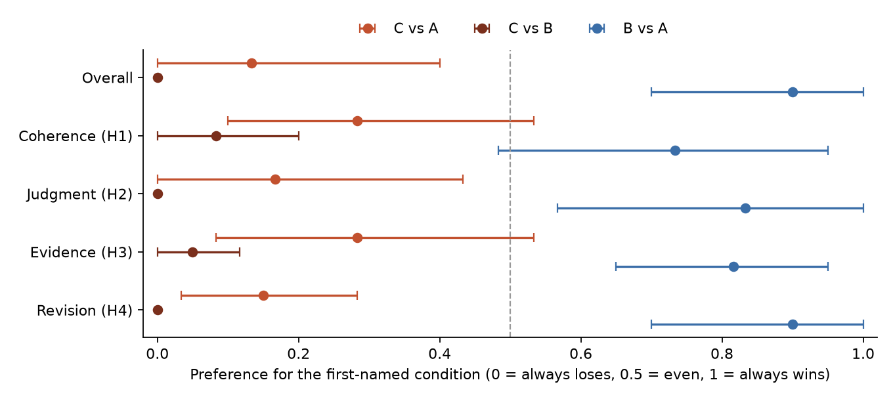
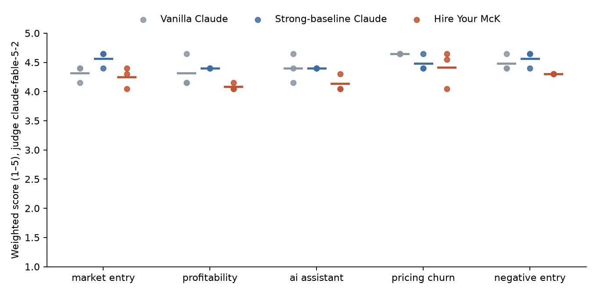

# Can a Claude Skill Actually Improve Strategic Reasoning? Testing Hire Your McK Against Vanilla Claude

*Benchmark report, November 2026. All case data is synthetic. Grades come from Claude judge models, not human
experts. Human review has not been done yet.*

## TL;DR

- We ran five synthetic strategy cases × three conditions × three replicates (45 runs), all with the same model
  (Claude Opus 5.5, effort high). **The Hire Your McK skill did not improve the strategic reasoning visible in its
  decks; it scored slightly lower than both baselines.** We graded the reasoning that reached the deliverable, as
  read by Claude judges, not the model's internal reasoning: an analysis that never made it onto a slide could not
  count.
  - Plain Claude beat the skill in 13 of 15 matched pairs; the skill won 2.
  - Claude with a six-line methodology prompt beat the skill in 15 of 15.
  - Every one of these verdicts held when the presentation order was reversed.
- **All three conditions reached the same strategic answer.** All 45 decks made a defensible recommendation. Each
  handled the case's initial hypothesis as the answer key expected (keep with conditions, revise, or reject) and
  fell into none of the planted traps. The differences are in how the argument is built and told, not in the
  conclusion.
- **The judges' main complaint about the skill's decks was length and repetition.**
  - In every run the skill chose its 30–60-slide deep-deck mode. Its decks were 2.2–2.7× longer (45 slides against
    17–20) and cost about twice as much to make.
  - Without the concision dimension, the gap to plain Claude is borderline (interval touches zero), and the gap to
    the methodology prompt remains. This is an exploratory analysis.
  - The two measures disagree on evidence and reasoning. On the absolute score the skill was level with the
    baselines (4.27 against 4.20), but the pairwise judge still preferred the baselines on evidence.
- **Shortening the deck did not fix it (exploratory follow-up, §4.7).** We added a fourth condition after seeing
  the main results: the skill in its default full-deck mode.
  - Length came down to the baselines' level (22 slides, about 3,100 words), and clarity recovered to 4.00, level
    with the baselines.
  - But the full-deck mode lost all 45 of its pairwise comparisons: 15 of 15 against plain Claude, against the
    methodology prompt and against the skill's own deep deck.
  - It had the fewest errors per document. The judges called it the leaner deck in most verdicts, then preferred
    the other deck, which gave the decision maker more sensitivities, alternatives, downside cases and decision gates.
- **The cheap methodology prompt was the strongest condition** in pairwise judging (13–1 against plain Claude).
- **The skill adds things the baselines did not produce:** a source workbook, editable native charts and its own QA
  pass, on 15 of 15 decks.
- **These findings are preliminary and directional, not statistically significant.** With 5 cases, no exact
  case-level test can reach p < 0.05 (the smallest attainable sign-flip p is 0.0625). The directions agree across two
  judge models, and the skill was behind in 5 of 5 cases in every comparison except one (4 of 5, secondary judge
  against the strong baseline). The hierarchical bootstrap intervals for the skill's deficit exclude zero,
  but with five cases they are optimistic and are not a significance test. Where the skill lost every pair, the
  bootstrap collapses to a single point; we report the observed count instead (§4.1).
- **A measurement bug we caught ourselves.** It had made the skill look worse. We fixed it and re-ran the whole
  evaluation for every condition. The conclusions held, with a smaller gap (§4.6).

## 1. Motivation

Hire Your McK is a Claude Skill that turns a brief into a consulting-style PowerPoint deck. Its README claims more
than layout: "Pretty slides are easy. The logic is the hard part." It promises a storyline that holds together and
a source for every number. Its deep-deck mode adds a hypothesis-driven seven-step workflow: an issue tree, and
verdicts that rewrite the storyline.

Frontier models already know the pyramid principle, MECE and action titles. So the question is whether a
structured, domain-specific workflow improves the **reasoning**, not just the formatting, beyond what the same
model does with ordinary prompting. We designed this benchmark to find out whether, where and why the skill adds
value, not to show that it wins.

## 2. System design: which parts of the skill could affect reasoning

Before building anything we classified the product's components
([`docs/01-system-understanding.md`](../docs/01-system-understanding.md)):

- **Reasoning:** governing thought → executive summary → action titles. In deep-deck mode: a problem worksheet,
  alternative issue trees, testable hypothesis sentences, knock-out analyses first, verdicts
  (confirmed/revised/refuted), and titles rewritten from the verdicts.
- **Structural compliance:** `check.py`, about 1,000 lines. It checks that executive-summary items map to slides,
  that title numbers appear on the slide, that estimates recompute and that title length is within limits. We do
  not count passing it as reasoning.
- **Factual verification:** `verify.py` re-opens web sources. With a self-contained evidence pack and no web
  access, this layer sits idle here.
- **Formatting:** slide-type routing, a 3,700-line renderer, themes and density targets.

## 3. Methodology (pre-registered, then frozen)

The full design is in [`METHODOLOGY.md`](../METHODOLOGY.md). File hashes at the freeze are in
[`FREEZE.json`](../FREEZE.json); post-freeze deviations are listed in §11 of the methodology.

**Conditions.** All three share one task: "Create a deck for [decision maker]: [question]. Work only from the
briefing pack. Save it in ./deliverable/. I won't be available; pick your recommended option and carry on."

- **A · Vanilla:** the task alone.
- **B · Strong baseline:** the task plus six generic method bullets written for this study, not the skill's text.
- **C · Hire Your McK:** `/hire-your-mck` followed by the task, with skill v1.2.0 loaded from a frozen snapshot.
- **C2 · Hire Your McK, full-deck mode (exploratory, added after the main results):** the same as C, but the
  request names the skill's default `deck_detailed` mode. See §4.7.

**Controls.**
- **Model:** Opus 5.5 at effort high for every condition, subagents included, on the same Claude Code version.
- **Tools:** Bash, Read, Write, Edit, Skill and Agent, with the same Python environment (the skill's declared
  dependencies).
- **Isolation:** a fresh workspace per run, with no user settings, CLAUDE.md, memory or MCP servers. A sandbox gave
  no network access and blocked reads of the repository, the answer keys, `~/.claude` and other runs. An audit of
  the transcripts found all 45 clean.
- **Sampling:** Claude Code exposes no temperature, so effort was fixed instead.
- **Ordering and selection:** run order was seeded at random. No run was retried, rerun or selected.

**Cases.** Five fictional companies, with synthetic but internally consistent data generated from code
([`cases/models.py`](../cases/models.py)):
- a Korean skincare brand entering the US;
- a regional grocer's margin decline;
- an SMB software firm's AI assistant;
- a SaaS price rise while churn rises, with two competing explanations;
- a startup tempted by a fast-growing, structurally unprofitable market.

Each pack gives management's initial hypothesis as context. The expected handling is keep with conditions in one
control case, revise in three cases and reject in one. Each pack also includes three planted problems: a
definitional inconsistency, a correlation-as-causation claim and a flawed internal metric. Hidden answer keys list
the insights, required calculations, critical evidence, traps, trade-offs and defensible recommendations.

**From deck to blind document.**
1. Deterministic extraction of text, tables, native chart data and notes from each `.pptx`. One run delivered a
   PDF.
2. Verbatim mapping to a common storyline schema by an isolated Opus 5.5 session, with a deterministic fidelity
   check.
3. Scrubbing of product markers and assignment of a random ID.

**Judges.**
- **Absolute:** a 1–5 rubric with anchors (framing 15%, coherence 25%, evidence & reasoning 25%, strategic
  judgment 25%, clarity & concision 10%). Scored by **Claude Fable 5.2** as primary judge, a different and
  stronger model than the generator, and **Claude Sonnet 5.5** as secondary judge.
- **Pairwise:** Fable 5.2 compared every replicate-matched pair (A–C, B–C, A–B), each shown in **both orders**.
- **Blinding:** judges saw the pack, the answer key and the blind document, never the condition.

**Pilots.** Two pilots (12 runs, excluded from results) found harness bugs and a ceiling effect. In response, the
packs were made more realistic and pairwise preference became a co-primary outcome. Both changes were made before
the freeze.

## 4. Results

### 4.1 Pairwise preference (co-primary)



| Comparison (15 rep-matched pairs each) | Overall preference for the first-named | 95% CI | Wins–losses (both orders agree) |
|---|---:|---|---|
| Hire Your McK vs Vanilla | 0.13 | 0.00–0.40 | 2–13 |
| Hire Your McK vs Strong baseline | 0.00 | not estimable (see note) | 0–15 |
| Strong baseline vs Vanilla | 0.90 | 0.70–1.00 | 13–1 (1 split) |

| Preference by hypothesis | Coherence (H1) | Judgment (H2) | Evidence (H3) | Revision (H4) |
|---|---:|---:|---:|---:|
| Hire Your McK vs Vanilla | 0.28 | 0.17 | 0.28 | 0.15 |
| Hire Your McK vs Strong baseline | 0.08 | 0.00 | 0.05 | 0.00 |
| Strong baseline vs Vanilla | 0.73 | 0.83 | 0.82 | 0.90 |

Position bias was negligible: the first-shown document won 49% of non-tied verdicts. The skill lost to the strong
baseline in every case; the sign-flip p is 0.0625, the smallest attainable with five cases.

*Note on the 0–15 result.* When every pair goes the same way, a bootstrap can only resample that result, so it
returns 0.00–0.00. That is not evidence that the true preference is zero. For reference, exact (Clopper-Pearson) 95%
upper bounds for 0 wins are 22% if the 15 pairs were independent and 52% if only the 5 cases were. The truth lies
between, because pairs within a case are correlated. The same applies to the full-deck mode's 0–15 results in §4.7.

The bootstrap intervals elsewhere in this report resample five cases, so read them as a description of these cases
rather than as population intervals.

### 4.2 Absolute scores (co-primary)



| Primary judge (Fable 5.2), mean [95% CI] | Vanilla | Strong baseline | Hire Your McK |
|---|---:|---:|---:|
| **Weighted (1–5)** | **4.43** [4.30, 4.57] | **4.48** [4.40, 4.57] | **4.24** [4.12, 4.37] |
| Problem framing | 5.00 | 5.00 | 5.00 |
| Storyline coherence | 4.33 | 4.13 | 4.07 |
| Evidence & reasoning | 4.20 | 4.20 | 4.27 |
| Strategic judgment | 4.60 | 5.00 | 4.33 |
| Clarity & concision | 4.00 | 4.00 | 3.20 |

| Paired, case-level (weighted) | Fable 5.2 | Sonnet 5.5 |
|---|---|---|
| Hire Your McK − Vanilla | −0.20 [−0.33, −0.08]; lower in 5/5 cases | −0.24 [−0.40, −0.09]; lower in 5/5 |
| Hire Your McK − Strong baseline | −0.25 [−0.35, −0.11]; lower in 5/5 | −0.17 [−0.39, −0.00]; lower in 4/5 |
| Strong baseline − Vanilla | +0.05 [−0.10, 0.20]; higher in 3/5, 1 tie | −0.06 [−0.28, 0.16]; higher in 2/5 |
| *Exploratory, without clarity & concision:* Hire Your McK − Vanilla | −0.13 [−0.26, 0.00] | −0.16 [−0.33, 0.01] |
| *Exploratory, without clarity & concision:* Hire Your McK − Strong | −0.19 [−0.30, −0.04] | −0.16 [−0.37, 0.01] |

Secondary judge weighted means: Vanilla 4.23, Strong baseline 4.17, Hire Your McK 3.99.

How to read these numbers:
- **Ceiling.** Scores sit near the top of the scale: problem framing was 5 for every document, and almost every
  other score is a 4 or a 5. Pairwise comparison is therefore the more sensitive measure.
- **Judge agreement.** The two judges agree on the direction of the condition effects. They agree only weakly on
  individual documents (Spearman 0.43 on the weighted score, low per-dimension kappa).
- **Length and score.** Across all documents, longer decks scored lower (Spearman −0.45). Within a condition the
  link is weak (−0.10, 0.20 and −0.33 for A, B and C).

### 4.3 Errors, coverage and hypothesis revision

| Per document (primary judge) | Vanilla | Strong baseline | Hire Your McK |
|---|---:|---:|---:|
| Unsupported claims (count) | 4.0 | 4.7 | 5.9 |
| Unsupported claims per 1,000 words | 1.14 | 0.99 | 0.91 |
| Numerical errors | 0.53 | 0.40 | 0.47 |
| Material contradictions | 0.73 | 1.20 | 0.87 |
| Unsupported causal claims | 0.93 | 1.33 | 1.53 |
| Critical evidence missed | 0 | 0 | 0 |
| Answer-key insights reached | 99% | 100% | 99% |
| Required calculations correct | 98% | 98% | 97% |
| Key trade-offs identified | 94% | 94% | 91% |
| Reasoning traps fallen into | 0% | 0% | 0% |
| Recommendation defensible | 100% | 100% | 100% |
| Initial hypothesis handled appropriately (H4) | 100% | 100% | 100% |

All 45 decks kept the control case's hypothesis with conditions, revised it in the three revise cases, and
rejected it in the negative case. They also avoided all five planted problems:
- the misleading market-size definition;
- the retail-halo correlation;
- the e-commerce margin that left out delivery;
- the survey's 6% response rate;
- the competitor evidence that partly supported the founders.

**H4 (hypothesis revision) cannot separate the conditions: all three are at the ceiling.** Error rates per word
are similar. The skill's decks contain more unsupported claims in absolute terms simply because they are longer.

### 4.4 Cost, time and output

| Mean per run | Vanilla | Strong baseline | Hire Your McK |
|---|---:|---:|---:|
| Cost (list-price estimate) | $2.92 | $3.45 | $6.94 |
| Wall time | 11.5 min | 14.0 min | 25.1 min |
| Slides | 16.7 | 20.1 | 44.6 |
| Words | 3,547 | 4,801 | 6,491 |
| Within-case SD of weighted score | 0.14 | 0.07 | 0.11 |

The skill chose its own mode and picked the 30–60-slide deep deck in every run. Main-benchmark cost at list-price
estimates: generation $199.59, normalisation $17.63, judges $165.19. The discarded v1 evaluation (§4.6) cost about
the same again.

### 4.5 End-to-end product (separate from reasoning)

| | Vanilla | Strong baseline | Hire Your McK |
|---|---:|---:|---:|
| `.pptx` delivered | 15/15 | 14/15 (one PDF) | 15/15 |
| Decks with editable native charts | 3/15 | 7/15 | 15/15 (11.7 per deck) |
| Source workbook tracing every number | 0/15 | 0/15 | 15/15 |
| Deck numbers found verbatim in the pack | 66% | 61% | 66% |
| Product's own QA (`check.py`) | — | — | 15/15 pass, 0 fail |

Visual design was not judged. That needs human review of the decks themselves.

### 4.6 A measurement error we found and corrected

While reading the judges' rationales after the first scoring pass (v1), we saw that 8 of 15 (Fable) and 12 of 15
(Sonnet) Hire Your McK documents were criticised for "section dividers that all carry the first section's title".
The decks did not have that flaw. Our extractor had titled each navigation slide with its largest list item instead
of its "Contents" or "Appendix" heading.

We fixed the extractor with a general rule that applies to every condition. We then re-normalised and re-judged
all 45 documents for all conditions, with the same blind IDs, rubric and models. The v2 numbers are the reported
results; v1 is archived in [`eval/_v1-extraction-bug/`](../eval/_v1-extraction-bug/).

| Weighted, primary judge | v1 (bug) | v2 (reported) |
|---|---|---|
| Vanilla / Strong / Hire Your McK | 4.49 / 4.45 / 4.15 | 4.43 / 4.48 / 4.24 |
| Hire Your McK − Vanilla | −0.34 [−0.48, −0.19] | −0.20 [−0.33, −0.08] |
| Hire Your McK − Strong baseline | −0.30 [−0.47, −0.15] | −0.25 [−0.35, −0.11] |
| Pairwise wins–losses, Hire Your McK vs Vanilla / vs Strong | 1–13 / 0–15 | 2–13 / 0–15 |

The bug roughly doubled the skill's apparent deficit against vanilla. The direction of every comparison was
unchanged.

### 4.7 Exploratory follow-up: the skill in its full-deck mode (C2)

**Why and how.** The skill's mode rule recommends the deep deck for any CEO or board decision, so condition C
measured that mode only. The obvious question is whether the skill does better at baseline length. After the main
results were known, we added condition C2: identical to C (same frozen skill snapshot, model, sandbox, packs and
auto-reply), except that the request begins `/hire-your-mck Mode: full deck with data (deck_detailed).`. We wrote
the design and its outcomes into [`METHODOLOGY.md`](../METHODOLOGY.md) §12 and hashed them
([`FREEZE-explore-c2.json`](../FREEZE-explore-c2.json)) before the first C2 run. We ran 15 runs (5 cases × 3).
The A, B and C documents and their judgments are reused unchanged. C2 was scored by the same judges and prompts
and compared pairwise, replicate-matched and in both orders, with A, with B and with C. **This is a post-hoc,
exploratory comparison. It does not change the pre-registered results above.**

**Mode check.** All 15 C2 runs stayed in `deck_detailed`: none opened the deep-deck workflow file. All 15 main C
runs had opened it. All 15 C2 runs completed with no retries, and all transcript audits were clean.

| Pairwise (Fable 5.2, 15 rep-matched pairs each) | Overall preference for C2 | Wins–losses (both orders agree) | Coherence | Judgment | Evidence | Revision |
|---|---:|---|---:|---:|---:|---:|
| C2 vs Vanilla | 0.00 | 0–15 | 0.17 | 0.00 | 0.00 | 0.03 |
| C2 vs Strong baseline | 0.00 | 0–15 | 0.15 | 0.00 | 0.00 | 0.00 |
| C2 vs Hire Your McK deep deck (C) | 0.00 | 0–15 | 0.30 | 0.02 | 0.00 | 0.17 |

The first-shown document won 50% of the non-tied verdicts. We checked the 90 raw verdicts directly, not only the
summary: C2 lost every one of them, in both presentation orders.

| Absolute, mean [95% CI] | Vanilla | Strong baseline | Hire Your McK (C, deep) | C2, full deck |
|---|---:|---:|---:|---:|
| Weighted, Fable 5.2 | 4.43 [4.30, 4.57] | 4.48 [4.40, 4.57] | 4.24 [4.12, 4.37] | 4.20 [4.12, 4.28] |
| Weighted, Sonnet 5.5 | 4.23 [4.10, 4.37] | 4.17 [3.99, 4.35] | 3.99 [3.91, 4.09] | 4.00 [3.88, 4.09] |
| Problem framing | 5.00 | 5.00 | 5.00 | 4.80 |
| Storyline coherence | 4.33 | 4.13 | 4.07 | 4.13 |
| Evidence & reasoning | 4.20 | 4.20 | 4.27 | 4.07 |
| Strategic judgment | 4.60 | 5.00 | 4.33 | 4.13 |
| Clarity & concision | 4.00 | 4.00 | 3.20 | **4.00** |

| Paired, case-level (weighted) | Fable 5.2 | Sonnet 5.5 |
|---|---|---|
| C2 − Vanilla | −0.23 [−0.38, −0.09]; lower in 5/5 | −0.23 [−0.36, −0.09]; lower in 5/5 |
| C2 − Strong baseline | −0.28 [−0.37, −0.19]; lower in 5/5 | −0.17 [−0.33, −0.01]; lower in 5/5 |
| C2 − Hire Your McK deep deck | −0.03 [−0.19, +0.09]; higher in 2/5 | +0.01 [−0.14, +0.12]; higher in 3/5 |
| *Without clarity & concision:* C2 − deep deck | −0.13 [−0.29, −0.00] | −0.10 [−0.25, +0.02] |

| Per document (Fable 5.2) | Vanilla | Strong baseline | Deep deck (C) | C2 |
|---|---:|---:|---:|---:|
| Numerical errors | 0.53 | 0.40 | 0.47 | 0.33 |
| Material contradictions | 0.73 | 1.20 | 0.87 | 0.53 |
| Unsupported claims per 1,000 words | 1.14 | 0.99 | 0.91 | 1.57 |
| Required calculations correct | 98% | 98% | 97% | 93% (10 partly correct, none wrong) |
| Key trade-offs identified | 94% | 94% | 91% | 86% |
| Recommendation defensible / hypothesis handled as expected | 100% / 100% | 100% / 100% | 100% / 100% | 100% / 100% |

| Mean per run | Vanilla | Strong baseline | Deep deck (C) | C2 |
|---|---:|---:|---:|---:|
| Slides (range) | 16.7 (14–21) | 20.1 (17–24) | 44.6 (40–51) | 21.6 (18–27) |
| Words | 3,547 | 4,801 | 6,491 | 3,096 |
| Words per slide (ratio of means) | ≈ 212 | ≈ 239 | ≈ 146 | ≈ 143 |
| Native charts | 1.5 | 3.3 | 11.7 | 8.2 |
| Cost (list-price estimate) | $2.92 | $3.45 | $6.94 | $4.93 |
| Wall time | 11.5 min | 14.0 min | 25.1 min | 18.3 min |
| Source workbook / `check.py` pass | 0 / — | 0 / — | 15 / 15 | 15 / 15 |

**What the judges said.** The full-deck mode produced the shortest documents of any condition and the fewest
numerical errors and contradictions. In 71 of the 90 verdicts, the judge's overall reasons call the C2 document
the leaner, tighter or more concise one (a keyword count over the reasons). The judge then preferred the other
document anyway, and gave the same reason in nearly every verdict. A typical one (c4, against the strong
baseline, where X is the C2 deck): "X is leaner, error-free and has the better-designed SMB test on renewals", but
the other deck "gives a risk-adjusted view: base and stress uplift, an explicit four-option comparison, the size
of the new-customer ARR gap under each, and a sensitivity and risk table". Against the skill's own deep deck in
c5, in two separate verdicts: "X's shorter length does not make up for the missing Zipcart
quantification", and the deep deck wins "because the extra length carries real reasoning rather than padding".

**Reading.**
- **Length alone does not explain the skill's deficit.** At baseline length the skill recovers the clarity score,
  but it loses judgment and evidence depth. Its absolute weighted score is the same as the deep deck's, and its
  pairwise record is worse.
- **The skill's slide grammar writes about 145 words per slide, against 210–240 for the baselines.** At about 22
  slides, it fits about two-thirds of the baselines' text, and what drops out is the material judges value: the
  sensitivity table, the explicit option comparison and the stress case. The deep deck has room for that material
  but spends much of the extra length on navigation and repetition. This is an interpretation of the judges'
  reasons, not something this design tested.
- **Caveats specific to C2.** It was added after the main results. Its absolute judgments were made on a later date
  than the main ones (same model ids and prompts), so a small drift cannot be excluded. The pairwise verdicts are
  not affected by that, because both documents are judged in the same call. C2 cost $181 at list-price estimates:
  generation $74.02, normalisation $3.75, absolute judges $15.71, pairwise $87.86.

## 5. Representative comparisons

These examples were chosen by fixed rules ([`scripts/examples.py`](../scripts/examples.py)). Full text and judge
rationales are in [`results/main/examples.md`](../results/main/examples.md).

- **Where the skill did best.** On the absolute scale, its best result is a tie with the better baseline (c1,
  replicate 3, 4.40 each). It never scored above the better baseline. In pairwise judging it beat plain Claude
  twice, both "slight" wins. In c1, replicate 3, the judge wrote that the skill's deck "gives the board a control
  rule that actually protects the binding constraint: its ACoS ceiling sits at the payback break-even and tightens
  with the tariff", whereas the vanilla deck's "triggers would let the launch run at ad costs that miss payback".
  In c5, replicate 2, the skill's deck "tests whether the recommended software path itself meets the investors'
  profitability-within-cash and runway constraints". In both wins, the hypothesis-driven gates paid off on the
  variable that decides the case.
- **About the same.** The same c1 trio: all three decks recommend an Amazon-led entry with gates and reject the
  600-door retail launch.
- **Where the skill did worst.** c4, replicate 2, 0.60 below the better baseline. The judge: "43 slides and about
  6,400 words is substantially more than this decision needs. There are five repeated contents slides,
  section-summary slides that restate the detail slides, and the same ARR bridge and 91% figure presented several
  times."
- **A substantive reasoning error by the skill.** c2, replicate 3. The deck's own bridge attributes 13% of the margin
  decline to store labor, yet its headline argues that cutting hours "cuts a cost that did not cause the decline".
  It calls labor "the smallest cause" when occupancy is smaller. Its labor reserve also takes hours out of
  well-staffed stores twice while assuming shrink falls, which conflicts with the hours-to-shrink link it uses to
  reject management's plan.
- **A substantive error by a baseline,** for balance. c3, vanilla, replicate 2. The title says "only a Pro tier
  passes all three tests", while the same slide rates the add-on as passing. It also counts six months of deferred
  revenue as lost ARR.

## 6. Interpretation (not proven by this design)

1. **The model's visible reasoning was already at this benchmark's ceiling.** Given a clean evidence pack, Opus 5.5
   at high effort found the crux, did the arithmetic, caught the planted traps and revised management's hypothesis
   in every condition. A workflow cannot raise what is already at the top of what this benchmark measures. The
   differences were in how much of the decision analysis reached the deliverable and how well it was told.
2. **The deep-deck format costs clarity, and to a lesser extent judgment.** Its long-deck grammar (a contents page
   before each section, a lead slide that indexes the evidence, a 15–30% appendix) was measured on public decks that
   are read section by section. A judge reading the whole argument experiences it as repetition. The skill's absolute evidence & reasoning score was level
   with the baselines (the pairwise judge still preferred the baselines on evidence), and its judgment score was
   lower. In the judges' words, its section headlines sometimes
   claim more than the body supports.
3. **Short method prompts help; a long rule set did not.** Six lines of generic method beat vanilla in 13 of 15
   pairs. The skill's roughly 50 rules and seven-step workflow did worse than either. The main design could not
   tell whether the rules crowd out analysis or the deep-deck length alone explains the gap. The exploratory
   full-deck arm (§4.7) points to the first: at baseline length the skill's decks lost even more clearly. Their
   compact slide format left out the sensitivities and option comparisons that the baselines wrote out.
4. **Where the skill helped, it helped on the right thing.** Both of its pairwise wins came from gates tied exactly
   to the binding constraint. That is the issue-tree discipline working. It was not enough to offset the cost in
   length.
5. **The product's value is elsewhere.** Traceable numbers, editable charts and a QA pass are real deliverable
   features. This benchmark deliberately does not score them as reasoning.

## 7. Failure cases and product findings

- **A baseline that missed its own tools.** One strong-baseline run did not find the preinstalled python-pptx, so it
  drew its deck as a PDF with a Swift script.
- **A renderer bug in the skill.** The renderer draws waterfall bars incorrectly once a running total goes below
  zero. Runs noticed this and switched to bar charts. The renderer was not changed during the benchmark.
- **Mode choice.** For every board decision, the skill chose the 30–60-slide mode, including single pricing or
  entry questions. When the request named the full-deck mode, the skill kept to it in 15 of 15 runs (§4.7).
- **Our own bug.** The benchmark's extraction error (§4.6) shows how easily a pipeline can bias a comparison.
  Reading the judges' reasons, not just their scores, is what caught it.

## 8. Limitations

- **Five cases.** The case is the unit of replication. Three replicates add precision within a case but not
  generality, and no case-level test can reach p < 0.05.
- **Synthetic cases written by the study's authors.** They are short compared with real engagements, and the answer
  keys reflect the authors' view of a defensible answer.
- **One generator model at one effort level.** A weaker model, lower effort, or messier and longer inputs might
  benefit more from a structured workflow. This is untested.
- **The skill ran unattended.** Its 3–4 human checkpoints were answered with "choose your recommended option". A
  user could have pushed back on the storyline. The shorter `deck_detailed` mode was tested only in the post-hoc
  exploratory arm (§4.7). The storyline-only and single-slide modes were not tested.
- **No web research.** The skill's source-verification layer, arguably its most distinctive feature, sat idle.
- **Claude judges only.** Fable 5.2 and Sonnet 5.5 judged Opus 5.5 outputs, so a style preference shared by Claude
  models cannot be ruled out. Per-document agreement between the two judges was weak.
- **Blinding is imperfect.** The judges guessed "specialised tool" for every document, so the blinding check tells
  us nothing. The skill's long-deck structure is recognisable.
- **Length is confounded with condition.** The exploratory analysis without the concision dimension narrows the gap
  but does not settle the question. The full-deck arm removes most of the length difference, but it was added after
  the results were known and is exploratory.
- **No human evaluation yet.** A package for three reviewers is ready (§10).

## 9. Lessons learned

- **Pilot first.** The pilots found six harness problems, one of which would have broken every run, and a ceiling
  effect that made 1–5 scores nearly useless.
- **Pairwise judgments in both orders** were far more sensitive than absolute rubric scores on strong outputs, with
  no measurable position bias.
- **Test against a good prompt, not only a bare one.** The cheap methodology prompt was the strongest condition.
- **Read the judges' reasons.** Systematic complaints about one condition can be artefacts of the pipeline.
- **Score a long-form deliverable format separately from reasoning.** We kept the two apart, and they told
  different stories.
- **Test the obvious alternative explanation before publishing it.** "The skill only loses because its decks are
  long" was the natural reading of the main result. Running the short mode showed that it was not the whole story.

## 10. Reproduce

```bash
git clone https://github.com/brianlee0113/hire-your-mck && cd hire-your-mck
benchmark/run_all.sh pilot   # optional
benchmark/run_all.sh main    # 45 runs + evaluation; several hours
# exploratory full-deck arm (needs the main phase's documents and judgments)
python3 benchmark/scripts/run_generation.py --phase explore-c2
for s in audit_runs extract_deck e2e_metrics; do benchmark/.venv/bin/python benchmark/scripts/$s.py --phase explore-c2; done
benchmark/.venv/bin/python benchmark/scripts/explore_c2.py all
```

You need a logged-in Claude Code with access to Opus 5.5, Fable 5.2 and Sonnet 5.5, plus `uv`. Details are in
[`benchmark/README.md`](../README.md). The `runs/main/` and `eval/main/` directories hold, for every run, the
prompt, the gzipped transcript, token use, cost, the extraction, the normalised storyline, the audit and all
judgments.

**Human review:** open `eval/main/human/index.html`, score the 45 blind documents and export the results. Once the
scores are imported, `scripts/analyze.py` computes inter-rater agreement (Krippendorff's alpha) and the human-vs-judge
correlation.
